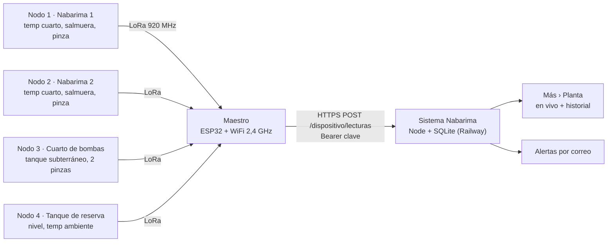

# 01 · Arquitectura

## Componentes

| Componente | Cantidad | Función |
|---|---|---|
| Nodo (Heltec WiFi LoRa 32 V3, ESP32-S3 + SX1262) | 4 | Lee los sensores de su zona y envía un paquete LoRa cada ~10 s |
| Maestro (misma placa) | 1 | Recibe por LoRa, arma un JSON y lo envía cada 10 s por WiFi (HTTPS) |
| Sistema Nabarima (Railway + Cloudflare) | 1 | Recibe, guarda, muestra en vivo y envía alertas por correo |

## Diagrama

## Nodos

| NODO_ID | Ubicación | Mide |
|---|---|---|
| 0 | Maestro, donde llegue el WiFi (oficina) | Nada; solo recibe y reenvía |
| 1 | Junto a Nabarima 1 (caja fuera del cuarto frío) | Temperatura del cuarto, nivel de salmuera, corriente de la máquina |
| 2 | Junto a Nabarima 2 (caja fuera del cuarto frío) | Temperatura del cuarto, nivel de salmuera, corriente de la máquina |
| 3 | Cuarto de bombas | Nivel del tanque subterráneo, corriente de bomba 1 y bomba 2 |
| 4 | Tanque de reserva (afuera, hay tomacorriente cerca) | Nivel del tanque de reserva, temperatura ambiente |

Distancias: los nodos quedan a unos 20 m del maestro y el de reserva a unos 15 m. LoRa cubre esas distancias de sobra con 10 dBm.

## Flujo de datos

1. Cada nodo lee sus sensores y envía un paquete binario de 19 bytes por LoRa cada ~10 s (más un desfase al azar para no chocar).
2. El maestro guarda lo último de cada nodo con su señal (RSSI) y cada 10 s envía los nodos nuevos en un JSON a `POST /dispositivo/lecturas`, con `Authorization: Bearer <clave>` y verificando el certificado HTTPS.
3. El sistema valida, guarda el último valor y un punto por minuto en el historial, deduce si cada máquina o bomba está en marcha por sus amperios y evalúa las alertas.

Se eligió HTTPS en lugar de MQTT porque el sistema está detrás de Cloudflare, que no deja pasar MQTT, y así no hace falta otro servidor.

## Respaldo de energía

- Cada placa (4 nodos y maestro) lleva una batería de 3000 mAh en su conector JST. Se carga con luz y la placa pasa a ella sin reiniciarse cuando se va.
- Autonomía estimada: 1 a 2 días por nodo; cerca de 1 día el maestro (usa WiFi todo el tiempo). Conviene alimentar el maestro desde el respaldo del router, que ya existe.
- Cada nodo detecta el corte de luz en GPIO 4 (divisor 10 kΩ / 15 kΩ desde los 5 V de la fuente) e informa su voltaje de batería.
- **Corte de luz:** como la medición del tablero eléctrico quedó fuera, el sistema infiere que se fue la luz cuando todos los nodos pasan a batería al mismo tiempo.
- Las baterías de litio no deben cargarse bajo 0 °C: las cajas de los nodos 1 y 2 van fuera del cuarto frío; solo entra la sonda.
